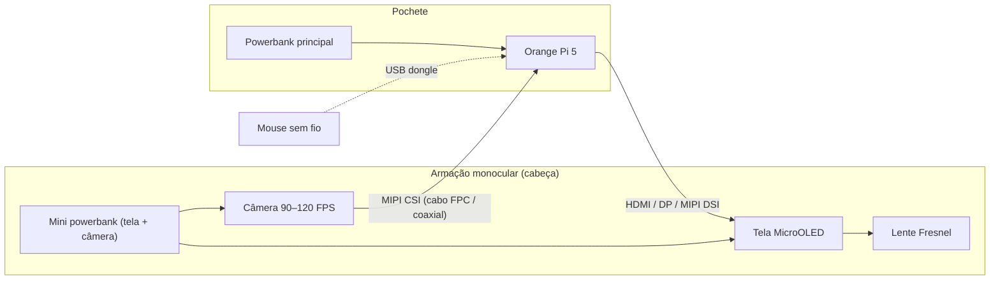

# Project-ME — Monóculo Digital de Melhoramento Visual com Zoom e Câmera de Alta Taxa de Quadros

> Publicação técnica aberta (open hardware / open source) com data de divulgação registrada neste repositório.
> Licenças: **GNU GPL v3.0** (software), **CERN-OHL-S v2** (hardware) e **CC BY-SA 4.0** (documentação e imagens) — ver seção [Licença](#licença).

**Autor:** Dr. Heinrich Stahlwerk \
**Data da primeira publicação:** 18/10/2026 \
**Versão deste documento:** 0.2 (conceito) \
**Status:** Conceito / Pré-protótipo

---

## Índice

1. [Resumo](#1-resumo)
2. [Problema que o projeto resolve](#2-problema-que-o-projeto-resolve)
3. [Visão geral da solução](#3-visão-geral-da-solução)
4. [Diagrama de blocos](#4-diagrama-de-blocos)
5. [Lista de componentes (BOM)](#5-lista-de-componentes-bom)
6. [Descrição detalhada de cada subsistema](#6-descrição-detalhada-de-cada-subsistema)
   - 6.1 Câmera
   - 6.2 Tela
   - 6.3 Sistema óptico (lente)
   - 6.4 Computador embarcado
   - 6.5 Alimentação
   - 6.6 Estrutura física / armação
   - 6.7 Interface de controle (mouse sem fio)
   - 6.8 Botões físicos
7. [Software e pipeline de vídeo](#7-software-e-pipeline-de-vídeo)
8. [Análise de latência](#8-análise-de-latência)
9. [Problemas em aberto](#9-problemas-em-aberto)
10. [Variações previstas](#10-variações-previstas)
11. [Roteiro (roadmap)](#11-roteiro-roadmap)
12. [Como reproduzir](#12-como-reproduzir)
13. [Licença](#licença)
14. [Como citar / registro de data](#como-citar--registro-de-data)

---

## 1. Resumo

Este projeto descreve um **monóculo digital (head-mounted display de vídeo "see-through" por câmera, para um único olho)** voltado ao **melhoramento visual**. Uma câmera de alta taxa de quadros (90 a 120 FPS) captura a cena à frente do usuário; o vídeo é processado em tempo real por uma placa Single Board Computer (SBC) **Orange Pi 5** e exibido em uma tela **MicroOLED**, vista através de uma **lente Fresnel**. O usuário controla o **zoom digital contínuo** por meio de um **mouse sem fio** (a rodinha amplia/reduz, o botão esquerdo retorna ao zoom padrão e os demais botões executam funções de contraste e congelamento de imagem).

O diferencial buscado: **baixa latência (objetivo inicial < 30 ms câmera-para-olho, meta ideal < 20 ms)**, uso de **hardware acessível** e **totalmente aberto**.

## 2. Problema que o projeto resolve

- **Público-alvo principal:** pessoas com baixa visão, que precisam ampliar objetos, textos e detalhes à distância ou de perto. Também é útil para quem faz trabalhos de precisão (relojoaria, eletrônica de bancada, inspeção).
- **Soluções existentes:** lupas eletrônicas, headsets de realidade virtual com passthrough de câmera e óculos para baixa visão. Suas limitações mais comuns são **preço elevado, latência perceptível, peso, volume e sistemas fechados**, que não permitem modificação ou reparo pelo usuário.
- **Problema principal que este projeto ataca: a latência.** Atraso entre a imagem real e a imagem exibida causa desconforto, enjoo e dificuldade de coordenação mão-olho. O projeto busca reduzi-lo usando câmera conectada por MIPI CSI (sem USB), taxa de quadros alta (90–120 FPS), processamento sem compressão de vídeo e renderização direta na tela.
- **Problemas secundários:** custo (uso de componentes comuns de mercado) e abertura (projeto totalmente documentado e reproduzível).

## 3. Visão geral da solução

Cadeia do sinal, de ponta a ponta:

```
Luz da cena → Lente da câmera → Sensor de imagem (90–120 FPS)
   → Interface MIPI CSI → Orange Pi 5 (ISP + processamento + zoom)
   → Saída de vídeo (HDMI / DisplayPort / MIPI DSI)
   → Tela MicroOLED → Lente Fresnel → Olho do usuário
```

Controle: mouse sem fio → USB (dongle) → Orange Pi 5 → software de zoom.

Divisão física:

| Parte                                  | Onde fica                                                                    |
| -------------------------------------- | ---------------------------------------------------------------------------- |
| Câmera, tela, lente, mini powerbank    | Armação na cabeça (monóculo, estilo óculos de precisão para relojoeiros)     |
| Orange Pi 5, powerbank principal       | Pochete transversal (a tiracolo)                                             |
| Mouse                                  | Mão do usuário                                                               |
| Ligação entre as duas partes           | Cabos (vídeo, câmera, alimentação)                                           |

## 4. Diagrama de blocos



## 5. Lista de componentes (BOM)

| #   | Componente               | Especificação desejada                                | Status      | Observações                                                          |
| --- | ------------------------ | ----------------------------------------------------- | ----------- | -------------------------------------------------------------------- |
| 1   | SBC                      | Orange Pi 5 (SoC Rockchip RK3588S), 8 GB de RAM       | Definido    | 4 GB provavelmente bastam; 8 GB dá margem                            |
| 2   | Câmera                   | Sensor com modo 90–120 FPS, interface MIPI CSI        | Em pesquisa | Ver seção 6.1; driver suportado no RK3588 é critério decisivo        |
| 3   | Tela                     | 1× MicroOLED                                          | Definido    | Ver seção 6.2                                                        |
| 4   | Lente                    | Fresnel                                               | Definido    | Ver seção 6.3                                                        |
| 5   | Mouse                    | Sem fio, com dongle USB                               | Definido    | Roda com clique + 2 botões, no mínimo                                |
| 6   | Powerbank principal      | 5 V / ≥ 4 A (pico), USB-C                             | A definir   | Alimenta o Orange Pi 5; ver seção 6.5                                |
| 7   | Mini powerbank           | 5 V / ≥ 2 A                                           | A definir   | Alimenta tela e câmera                                               |
| 8   | Case do Orange Pi 5      | Impressão 3D ou comercial                             | A projetar  | Ventilação ativa/passiva                                             |
| 9   | Conectores / adaptadores | Cabos MIPI CSI, vídeo, energia                        | A projetar  | Ver seção 6.4                                                        |
| 10  | Armação                  | Monóculo estilo óculos de precisão, impressa em 3D    | A projetar  | Ver seção 6.6                                                        |
| 11  | Pochete transversal      | Para SBC e powerbank                                  | Definido    |                                                                      |
| 12  | Botões / chaves          | Liga/desliga tela e Orange Pi                         | A projetar  | Ver seção 6.8                                                        |

## 6. Descrição detalhada de cada subsistema

### 6.1 Câmera

**Objetivo:** capturar a cena com o menor atraso possível.

- **Taxa de quadros:** 90 FPS ou 120 FPS. A 120 FPS cada quadro dura ≈ 8,33 ms; a 90 FPS, ≈ 11,1 ms. Taxa maior reduz diretamente o atraso de captura e deixa o movimento mais natural.
- **Interface:** MIPI CSI-2 (conexão direta ao SoC, sem passar por USB, para evitar o custo de compressão/protocolo de câmeras USB UVC).
- **Configuração:** 1 câmera central, alinhada ao olho que usa o monóculo (visão ciclópica).
- **Sensores candidatos (a avaliar, sujeitos à verificação de driver no kernel do RK3588):**
  - Sensor IMX708 (Raspberry Pi Camera Module 3): modo de 120 FPS em resolução reduzida (cerca de 1536×864), colorido, rolling shutter.
  - Sensor OV9281: global shutter, cerca de 1280×800 a 120 FPS, porém monocromático.
  - Qualquer sensor MIPI CSI com driver suportado que entregue ≥ 90 FPS em resolução igual ou superior à da tela.
- **Lente da câmera:** campo de visão desejado entre 60° e 90°, foco fixo no protótipo inicial; foco ajustável e foco automático como evolução.
- **Obturador:** rolling shutter é aceitável no protótipo, pois a taxa de quadros é alta; global shutter é desejável na versão final porque evita distorção em movimento rápido.
- **Zoom:** digital (recorte + escala da imagem). Zoom óptico fica como evolução futura.
- **Limite do zoom digital:** o zoom digital recorta a imagem e perde resolução. Em zoom de 4×, apenas 1/16 dos pixels do sensor é usado. Por isso, quanto maior a resolução do sensor em relação à tela, maior o zoom útil. Existe um compromisso direto entre **resolução e FPS** do sensor, que será medido nos testes.

> ⚠️ A taxa de quadros anunciada pelo sensor normalmente vale apenas para resoluções/modos específicos. Registre aqui o modo exato testado: resolução, FPS, número de lanes, formato de pixel.

### 6.2 Tela

Decisão: **1 tela MicroOLED** (monóculo, um olho).

| Tipo                | Vantagens                                                       | Desvantagens                                                  |
| ------------------- | --------------------------------------------------------------- | ------------------------------------------------------------- |
| **1 tela MicroOLED** | Alta densidade de pixels, compacta, leve, baixo consumo, tempo de resposta muito rápido | Mais cara que LCD, exige placa controladora (driver board)    |

Requisitos desejados: taxa de atualização ≥ 90 Hz (idealmente 120 Hz, igual à câmera), baixa persistência, baixa latência de interface.

Interface de vídeo escolhida inicialmente: **HDMI**, por ser a saída nativa do Orange Pi 5 e a mais simples de testar com placas controladoras de MicroOLED. **MIPI DSI** fica como alternativa futura para reduzir a latência da interface. DisplayPort (via USB-C alt mode) também é possível.

### 6.3 Sistema óptico (lente)

Decisão: **lente Fresnel**.

| Tipo        | Espessura                                 | Qualidade                                | Custo | Comentário                             |
| ----------- | ----------------------------------------- | ---------------------------------------- | ----- | -------------------------------------- |
| **Fresnel** | Média/grande (distância tela–lente maior) | Anéis visíveis, menor nitidez nas bordas | Baixo | Mais simples de prototipar             |

Parâmetros a documentar: distância focal, distância tela-lente, campo de visão (FOV), eye relief (distância do olho à lente), tamanho da pupila de saída (eyebox) e correção de distorção (software, ver seção 7). Como o projeto é monocular, a distância interpupilar (IPD) não é crítica, mas o **alinhamento da lente com a pupila** deve ser ajustável.

**Olho livre:** o outro olho permanece aberto e vê o mundo real. Isso pode causar disputa binocular (o cérebro alterna entre as duas imagens). Opções a testar: usar o olho livre normalmente (como em uma lupa de relojoeiro), cobrir com tampa removível ou basculante, ou usar película semitransparente. O resultado será documentado após os testes.

### 6.4 Computador embarcado — Orange Pi 5

- **SoC:** Rockchip RK3588S (CPU 8 núcleos, GPU Mali-G610, NPU, ISP).
- **Funções:** capturar vídeo da câmera, aplicar zoom/correção, enviar imagem à tela, ler o mouse.
- **Case:** a projetar, com ventilação (o RK3588S esquenta em carga contínua) e aberturas para: USB-C (energia), conectores de câmera MIPI CSI, saída de vídeo, USB (dongle do mouse), GPIO (botões).
- **Conector / adaptador necessário:** adaptador para levar o MIPI CSI (cabo FPC plano) até a cabeça. Cabos FPC planos são sensíveis a ruído e comprimento; avaliar:
  - cabo FPC curto reforçado e blindado;
  - placas conversoras MIPI CSI → coaxial/GMSL/FPD-Link para distâncias maiores;
  - posicionamento da pochete mais perto da cabeça (ex.: nuca/ombro).
- **Observação:** verificar a documentação oficial da placa para número de interfaces MIPI CSI, lanes por interface e modos suportados antes de definir o sensor.

### 6.5 Alimentação

Arquitetura planejada com **duas fontes separadas**:

1. **Powerbank principal** (na pochete): alimenta o Orange Pi 5 (5 V, corrente de pico alta; verificar se o powerbank entrega 5 V estável em ≥ 4 A. Se só negociar 9 V ou 12 V por PD, será necessário um módulo conversor).
2. **Mini powerbank** (na armação): alimenta tela e câmera, reduzindo o cabo de energia que sobe até a cabeça.

Pontos de atenção:

- **Terra comum (GND):** ao ligar câmera/tela alimentadas por uma fonte a um SBC alimentado por outra, é preciso garantir referência de terra comum nos sinais, sem criar laços de corrente.
- **Autonomia estimada:** `autonomia (h) = capacidade (Wh) ÷ consumo (W)`. Exemplo: powerbank de 20 Wh e consumo total de 7 a 10 W resulta em cerca de 2 a 3 horas. Os valores serão substituídos pelas medições reais.
- **Proteções:** fusível/PTC, proteção contra inversão de polaridade, regulação de tensão.
- Powerbanks costumam desligar sozinhos com baixo consumo; verificar modelos com modo de "carga baixa" ou usar um regulador (buck) com bateria Li-ion própria.

### 6.6 Estrutura física / armação

- Formato de **monóculo**, inspirado nos óculos de precisão usados por relojoeiros (peça frontal com a lente diante de um olho, presa por tiras/arco de cabeça).
- Abriga: tela, lente, câmera (na face frontal), mini powerbank (traseira/topo, para equilibrar o peso).
- Material: impressão 3D em **PETG ou ASA** (o PLA amolece com calor e suor); espuma facial para conforto.
- Ajustes: posição da lente em relação à pupila, distância tela-lente (foco), ajuste de cintas.
- Arquivos CAD: pasta `/hardware/cad/` (STL, STEP, projeto-fonte).
- Peso alvo: **< 250 g** na cabeça.

### 6.7 Interface de controle — mouse sem fio

| Entrada                 | Função                                                                        |
| ----------------------- | ----------------------------------------------------------------------------- |
| Rolar a roda para cima  | Aumenta o zoom                                                                |
| Rolar a roda para baixo | Diminui o zoom                                                                |
| Botão esquerdo          | Retorna ao zoom padrão (1×)                                                   |
| Botão direito           | Alterna entre modos de contraste (normal → alto contraste → invertido → ...)  |
| Clique da roda          | Congela / descongela a imagem (útil para leitura)                             |

Implementação: evento de entrada lido do sistema (`evdev`/libinput) por um serviço do projeto, que ajusta o fator de zoom aplicado no pipeline de vídeo. Zoom com suavização (interpolação) para evitar saltos bruscos.

### 6.8 Botões físicos

Necessidade: **ligar/desligar a tela** e **ligar/desligar com segurança o Orange Pi**.

Ideias a explorar:

- Botão de **desligamento seguro** ligado a um pino GPIO, tratado por serviço que executa `shutdown` (evita corromper o cartão/SSD).
- Chave física no cabo de alimentação da tela e da câmera (interrompe a energia da armação).
- Controle da tela por software (desligar saída de vídeo / backlight) acionado por um botão em GPIO.
- Botão de energia do próprio Orange Pi (verificar existência/pinos na documentação da placa).

## 7. Software e pipeline de vídeo

**Sistema operacional:**

| Distro         | Prós                                              | Contras                                                                                                        |
| -------------- | ------------------------------------------------- | -------------------------------------------------------------------------------------------------------------- |
| Gentoo (ARM64) | Total controle, binários otimizados para o RK3588 | Compilação demorada, dependência dos drivers proprietários/vendor de câmera e GPU, mais trabalho de manutenção |

**Decisão atual:** Gentoo Linux. **Critério principal:** suporte funcional ao ISP e à câmera MIPI CSI na taxa desejada.

**Plano de compilação:** o Gentoo será compilado e preparado em um computador externo. Possível ideia: usar computação em nuvem para compilar os pacotes e o Orange Pi 5, conectado à internet, apenas instalará os binários. Para isso funcionar:

- o servidor de compilação deve ser **arm64** (ou usar cross-compilação / qemu-user);
- deve usar as **mesmas flags** `CFLAGS` e `USE` do Orange Pi 5, publicadas como *binhost*;
- o Orange Pi só precisa de internet para instalar e atualizar; durante o uso ele opera offline. (O que pode ser resolvido, se conectando a rede com fio, pelo menos uma vez por semana, para atualizações de segurança).

**Kernel e bootloader:** a câmera e o ISP do RK3588 dependem, em geral, do **kernel do fabricante (Rockchip BSP)** e do U-Boot correspondente. A versão exata do kernel, do U-Boot e dos drivers usados será registrada neste repositório após os testes.

**Pipeline planejado:**

1. Captura da câmera via V4L2 (ou libcamera/GStreamer), em formato bruto/NV12 (sem compressão).
2. Processamento na GPU (OpenGL ES / Vulkan / OpenCL) ou no RGA (acelerador 2D do Rockchip): recorte, escala (zoom), correção de distorção da lente, melhoria de contraste/brilho, etc.
3. Renderização direta (DRM/KMS) no framebuffer da tela, evitando servidor gráfico/compositor para reduzir atraso.
4. Serviço de entrada lê o mouse e atualiza o zoom.

**Boas práticas de baixa latência:** zero cópia de buffers (DMA-BUF), sem codificação/decodificação de vídeo, buffers mínimos (1–2 quadros), sincronização com o *vsync* da tela.

**Funções futuras de melhoramento visual:** realce de contraste, inversão de cores, realce de bordas, filtros para daltonismo, modo noturno, estabilização de imagem, controle de foco automático.

## 8. Análise de latência

Latência total (câmera → olho) é a soma:

```
Exposição do sensor + leitura do sensor + transferência CSI
 + processamento no SoC + envio ao display + varredura do display
```

Metas e medições (estimativas teóricas, a confirmar com testes):

| Etapa                               | Estimativa      | Medido |
| ----------------------------------- | --------------- | ------ |
| Captura/leitura do sensor (120 FPS) | ~8 ms           | A medir |
| Transferência + ISP                 | 4–8 ms          | A medir |
| Processamento (zoom)                | 2–4 ms          | A medir |
| Saída ao display                    | 4–8 ms          | A medir |
| Varredura da tela                   | 4–8 ms          | A medir |
| **Total**                           | **meta: < 30 ms (ideal < 20 ms)** | A medir |

**Método de medição sugerido:** filmar com câmera de alta velocidade um LED/cronômetro visto pela câmera do monóculo e comparar com o mesmo LED a olho nu; ou usar um LED + fotodiodo e osciloscópio.

## 9. Problemas em aberto

1. **Tipo de cabo correto para não gerar atraso.** MIPI CSI é um barramento físico direto, então o cabo em si não adiciona atraso perceptível, mas limita taxa, comprimento e imunidade a ruído. Investigar: comprimento máximo do FPC, blindagem, impedância, conversores coaxiais (GMSL/FPD-Link) e o número de lanes necessário para 120 FPS na resolução escolhida.
2. **Como ligar os botões** de desligamento da tela e do Orange Pi (GPIO + serviço de shutdown, chaves de corte de energia, etc.).
3. **Suporte a câmera e ISP no Gentoo** para o RK3588: validar kernel do fabricante, U-Boot e drivers, e documentar a configuração que funcionar. Alternativa de contingência, se necessário: Armbian ou Ubuntu para RK3588 como base de testes.
4. **Escolha final do sensor de câmera** (resolução × FPS × driver suportado).
5. **Disputa binocular** (olho livre): definir se o outro olho fica aberto, coberto ou parcialmente filtrado.
6. **Qualidade da lente Fresnel** com MicroOLED (anéis visíveis, nitidez nas bordas, visibilidade da grade de pixels).
7. Dissipação térmica do Orange Pi 5 dentro de uma pochete.
8. Ergonomia e peso na cabeça.

## 10. Variações previstas

Para registrar o escopo da invenção, este projeto também contempla as seguintes variações, sem se limitar a elas:

- Versão **monocular** (um olho) ou **binocular** (dois olhos, com uma ou duas telas e uma ou duas câmeras, com ou sem estéreo).
- Uso de **outro SBC/SoC** (outros Rockchip, Raspberry Pi, Jetson, etc.) no lugar do Orange Pi 5.
- Uso de **uma ou mais câmeras**, inclusive câmeras com zoom óptico, infravermelho ou térmicas.
- Uso de **qualquer tecnologia de tela** (AMOLED, MicroOLED, LCD, LCoS, MicroLED) com **qualquer tipo de lente** (Pancake, Fresnel, asférica, de múltiplos elementos).
- **Controle** por mouse, controle remoto, botões na armação, voz, rastreamento ocular ou gestos.
- **Alimentação** por uma ou mais baterias/powerbanks, ou bateria integrada à armação.
- **Conexão sem fio** entre o módulo de captura e o módulo de processamento.
- **Aplicações:** baixa visão, leitura, relojoaria, inspeção de eletrônicos, observação à distância, uso industrial, uso em cirurgia/microscopia, acessibilidade em geral.

## 11. Roteiro (roadmap)

- [ ] Definir sensor de câmera e validar 90–120 FPS no Orange Pi 5
- [ ] Validar Gentoo com kernel do fabricante e driver de câmera/ISP
- [ ] Prototipar pipeline câmera → tela com zoom por software
- [ ] Medir latência real
- [ ] Validar tela MicroOLED com lente Fresnel em bancada óptica
- [ ] Projetar e imprimir armação monocular v1
- [ ] Projetar case e adaptador do Orange Pi
- [ ] Integrar alimentação e botões
- [ ] Integrar controle por mouse
- [ ] Testes de uso, ergonomia e autonomia
- [ ] Documentar tudo com fotos, vídeos e arquivos CAD

## 12. Como reproduzir

*(Esta seção será preenchida conforme o projeto avança. Mantenha-a atualizada com cada teste.)*

Documentação planejada (será adicionada ao repositório):

1. Lista de materiais com links e preços: `docs/bom.md`
2. Montagem do hardware: `docs/montagem.md`
3. Instalação do sistema: `docs/sistema.md`
4. Instalação do software: `docs/software.md`
5. Calibração da lente e do zoom: `docs/calibracao.md`

**Estrutura sugerida do repositório:**

```
/
├─ README.md
├─ LICENSE
├─ docs/               (documentação detalhada, esquemas, medições)
├─ hardware/
│   ├─ cad/            (STL, STEP)
│   ├─ esquematicos/   (diagramas elétricos)
│   └─ bom.md
├─ software/
│   ├─ pipeline/       (captura, zoom, renderização)
│   └─ input/          (serviço do mouse e botões)
├─ imagens/            (fotos, diagramas)
└─ testes/             (medições de latência, logs)
```

## Licença

- **Software:** GNU General Public License v3.0 (GPL-3.0). Veja o arquivo `LICENSE`.
- **Hardware (CAD, esquemas, PCBs):** CERN Open Hardware Licence Version 2 – Strongly Reciprocal (CERN-OHL-S-2.0).
- **Documentação e imagens:** Creative Commons Attribution-ShareAlike 4.0 (CC BY-SA 4.0).

Qualquer pessoa pode usar, estudar, modificar e distribuir, desde que mantenha a mesma licença em obras derivadas e preserve os avisos de autoria.

## Como citar / registro de data

Este repositório serve como **divulgação técnica pública** do projeto, com data comprovada pelo histórico de commits do Git.

Para reforçar o registro de data:

- Faça *commits* frequentes, com mensagens claras e datas reais (não reescreva o histórico).
- Crie uma **release/tag** a cada versão (`v0.1-conceito`, `v0.2-conceito`, `v0.3-prototipo`, ...).
- Arquive o repositório no **Zenodo** (gera DOI e carimbo de data) e/ou no **Internet Archive (Wayback Machine)**.

**Citação sugerida:**

> STAHLWERK, Heinrich. *Project-ME: Monóculo digital de melhoramento visual com zoom e câmera de alta taxa de quadros*. 2026. Disponível em: [URL do repositório]. DOI: [DOI do Zenodo].
